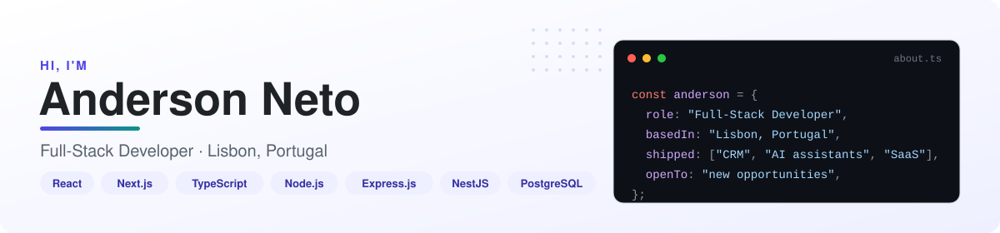
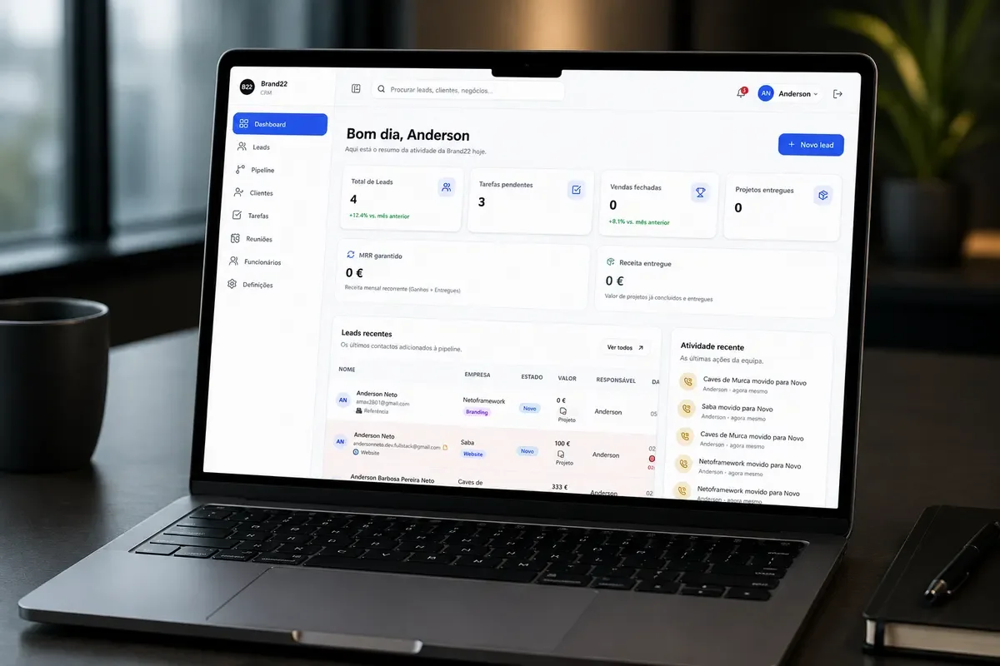
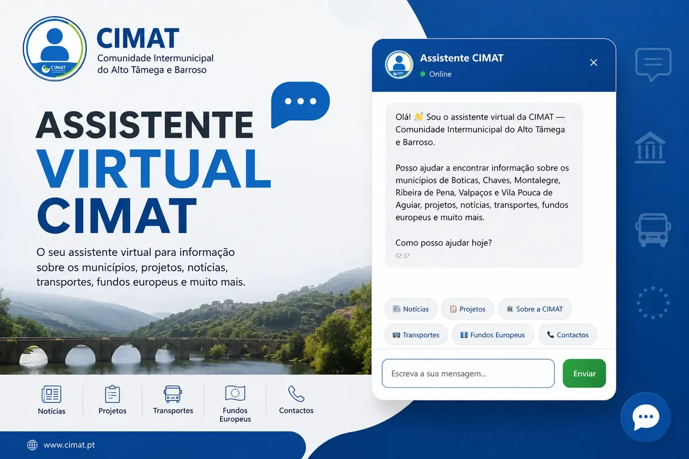
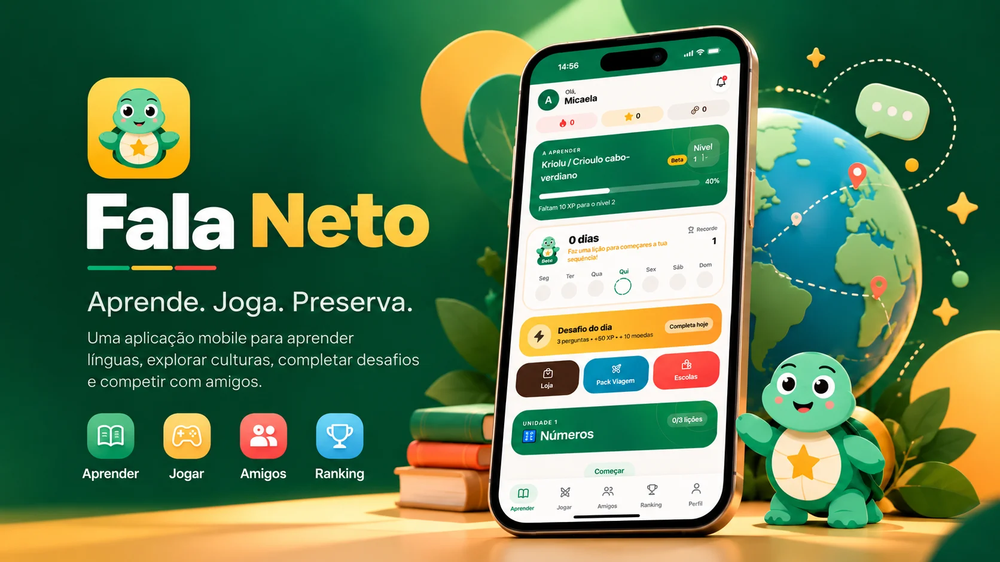
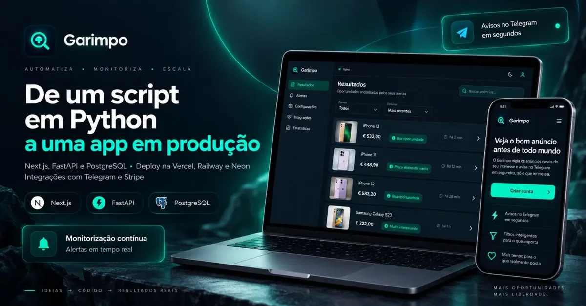
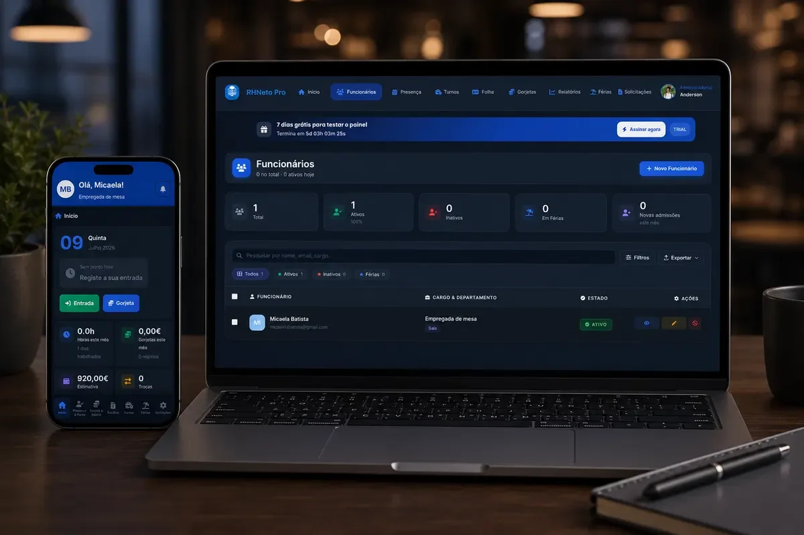
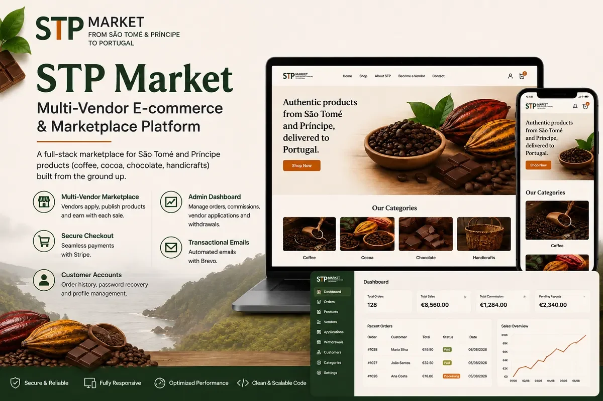
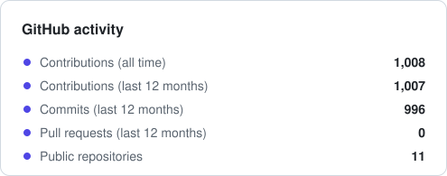
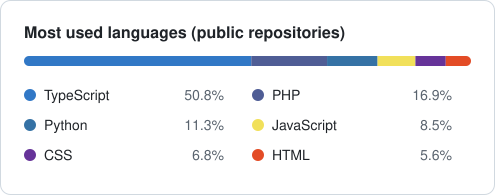

<picture>
  <source media="(prefers-color-scheme: dark)" srcset="assets/banner-dark.svg">
  
</picture>

  
  
  

## About me

I'm a Full-Stack Developer based in **Lisbon, Portugal**. I build web applications end to end, from React and Next.js interfaces to REST APIs, databases and deployment.

- 💼 At **Brand22 Creative Agency** I built the agency's internal CRM and AI virtual assistants that are **live on public-sector websites**.
- 🚀 I ship my own products too: a language-learning app with a real-time multiplayer arena, a Vinted alerts SaaS with 200+ tests and a multi-vendor marketplace.
- 🧪 I care about the unglamorous parts: tests, CI, server-side validation, idempotent payments and clear documentation.
- 🎯 **Open to Full-Stack, Frontend and Backend Developer roles in Portugal.**

## Tech stack

  <b>Front-end</b> 
  

  <b>Back-end</b> 
  

  <b>Data</b> 
  

  <b>Tools and cloud</b> 
  

**Also familiar with:** C# / .NET · **Learning:** AWS

## Professional work

<table>
  <tr>
    <td width="50%" valign="top">
      
      <h3>Brand22 CRM · in production</h3>
      Internal CRM for the agency: kanban sales pipeline, leads, tasks reviewed between staff and admin, and a client portal to approve projects. Website leads arrive through a webhook and a daily cron sends proposal follow-ups.
        
      <code>React</code> <code>TanStack Start</code> <code>TypeScript</code> <code>Serverless API</code> <code>MySQL</code> <code>Resend</code>
        
      🔒 Private repository (company project)
    </td>
    <td width="50%" valign="top">
      
      <h3>CIMAT Virtual Assistant · in production</h3>
      AI assistant on the official website of the Comunidade Intermunicipal do Alto Tâmega e Barroso. The widget calls a WordPress REST route in PHP, so the AI key never reaches the browser. I also built the AMAT assistant and the Brand22 chatbot.
        
      <code>JavaScript</code> <code>PHP</code> <code>WordPress REST API</code> <code>Claude API</code>
        
      🌐 <a href="https://cimat.pt/">Live website</a>
    </td>
  </tr>
</table>

## Featured projects

<table>
  <tr>
    <td width="50%" valign="top">
      
      <h3>Fala Neto</h3>
      Mobile app to learn African languages, with lessons, a daily challenge and a <b>real-time multiplayer Arena</b>. Server-authoritative game rules, a content review workflow and 114 tests in CI.
        
      <code>Expo</code> <code>React Native</code> <code>NestJS</code> <code>Socket.IO</code> <code>Prisma</code> <code>Turborepo</code>
        
      📂 <a href="https://github.com/anderson-fullstack-developer/app_stp">Repository</a>
    </td>
    <td width="50%" valign="top">
      
      <h3>Garimpo</h3>
      Multi-user SaaS that monitors new Vinted listings in the background, filters them per alert, removes duplicates and sends matches to Telegram in seconds. Stripe subscriptions and <b>200+ automated tests</b>.
        
      <code>Next.js</code> <code>FastAPI</code> <code>Python</code> <code>PostgreSQL</code> <code>Stripe</code> <code>Pytest</code>
        
      📂 <a href="https://github.com/anderson-fullstack-developer/vinted">Repository</a> · 🌐 <a href="https://garimpo-xi-ten.vercel.app">Live demo</a>
    </td>
  </tr>
  <tr>
    <td width="50%" valign="top">
      
      <h3>RHNeto Pro · final project, 20/20</h3>
      Restaurant staff management: a management panel (staff, time clock, shifts, payroll with tips, holidays, reports) and an employee app on the same database.
        
      <code>PHP</code> <code>MySQL</code> <code>JavaScript</code> <code>Stripe</code> <code>Infobip SMS</code>
        
      📂 <a href="https://github.com/anderson-fullstack-developer/rhneto-pro">Repository</a>
    </td>
    <td width="50%" valign="top">
      
      <h3>STP Market</h3>
      Multi-vendor marketplace for products from São Tomé and Príncipe: vendor approval, commissions, withdrawals and Stripe Checkout with an <b>idempotent webhook</b>.
        
      <code>Next.js</code> <code>TypeScript</code> <code>Prisma</code> <code>Stripe</code> <code>Clerk</code> <code>Auth.js</code>
        
      📂 <a href="https://github.com/anderson-fullstack-developer/ecommerce-marketplace">Repository</a> · 🌐 <a href="https://stp-dusky.vercel.app">Live demo</a>
    </td>
  </tr>
  <tr>
    <td width="50%" valign="top">
      
      <h3>ScreenRoom</h3>
      Real-time screen sharing in private rooms over WebRTC, with invite links, host controls, room chat and an admin panel. Unit and end-to-end tests.
        
      <code>Next.js</code> <code>LiveKit</code> <code>WebRTC</code> <code>PostgreSQL</code> <code>Redis</code> <code>Playwright</code>
        
      📂 <a href="https://github.com/anderson-fullstack-developer/app_screm">Repository</a> · 🌐 <a href="https://app-screm.vercel.app">Live demo</a>
    </td>
    <td width="50%" valign="top">
      
      <h3>App Transfer</h3>
      Family-to-student transfers (simulation mode) built as a modular monolith: transfer state machine, idempotency keys, money-safe maths and integration tests against a real database.
        
      <code>NestJS</code> <code>Next.js</code> <code>Prisma</code> <code>PostgreSQL</code> <code>Jest</code> <code>Turborepo</code>
        
      📂 <a href="https://github.com/anderson-fullstack-developer/app_transfer">Repository</a> · 🌐 <a href="https://marrocospay.vercel.app">Live demo</a>
    </td>
  </tr>
</table>

## GitHub stats

  <picture>
    <source media="(prefers-color-scheme: dark)" srcset="assets/stats-dark.svg">
    
  </picture>
  <picture>
    <source media="(prefers-color-scheme: dark)" srcset="assets/languages-dark.svg">
    
  </picture>

  <picture>
    <source media="(prefers-color-scheme: dark)" srcset="https://streak-stats.demolab.com?user=anderson-fullstack-developer&theme=github-dark-blue&hide_border=false&border_radius=10">
    
  </picture>

<picture>
  <source media="(prefers-color-scheme: dark)" srcset="assets/snake-dark.svg">
  
</picture>

Stats and the snake are regenerated every day by a GitHub Action in this repository.
